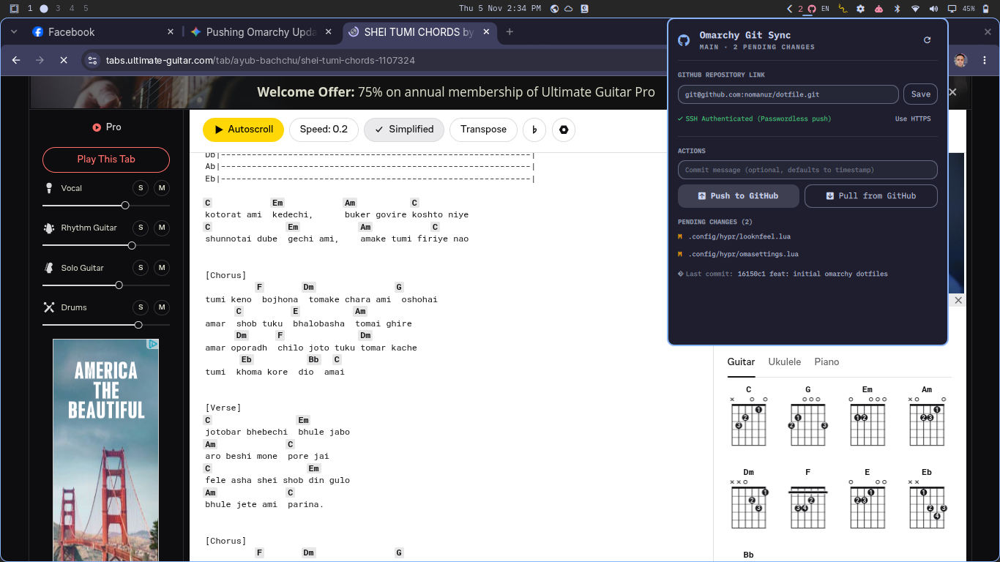

# Omarchy DotSync

A native Omarchy shell status bar plugin for syncing, backing up, and restoring your Omarchy configurations and dotfiles with GitHub.



## Features

- **Top Bar Integration**: Sits cleanly on the Omarchy status bar with a GitHub icon and dynamic badge showing modified file count.
- **Configurable Repository**: Enter or update your GitHub repository URL (`git@github.com:...` or `https://github.com/...`) right from the panel.
- **One-Click Push**: Automatically stages modified configs, creates a timestamped commit (or custom message), and pushes to GitHub.
- **One-Click Pull**: Pulls the latest configs from GitHub so other machines or fresh setups sync to the exact same state.
- **SSH & HTTPS Support**: Instant one-click toggle between SSH and HTTPS URL formats.
- **Live Status**: Shows current branch, ahead/behind commits, modified configuration files, and last commit details.
- **Desktop Notifications**: Sends desktop alerts upon push or pull completion.

## Installation

Install and enable the plugin in Omarchy with a single command:

```bash
omarchy plugin add https://github.com/nomanur/omarchy-dotsync.git --enable
```

## Removal

To disable and remove the plugin:

```bash
omarchy plugin remove io.github.nomanur.dotsync --yes
```

## Updating

To update the plugin to the latest version:

```bash
omarchy plugin update io.github.nomanur.dotsync
```

## Structure

```
~/.config/omarchy/plugins/io.github.nomanur.dotsync/
├── manifest.json       # Omarchy shell plugin manifest
├── BarWidget.qml       # Bar icon and dropdown panel UI
├── preview.png         # Screenshot preview
├── bin/
│   └── dotsync-ctl     # Backend python script for git operations
├── LICENSE             # MIT license
└── README.md
```

## IPC Commands

You can control the plugin via `omarchy-shell`:

```bash
omarchy-shell io.github.nomanur.dotsync toggle   # Toggle the dropdown panel
omarchy-shell io.github.nomanur.dotsync open     # Open the panel
omarchy-shell io.github.nomanur.dotsync close    # Close the panel
omarchy-shell io.github.nomanur.dotsync refresh  # Refresh git status
omarchy-shell io.github.nomanur.dotsync push     # Push to GitHub
omarchy-shell io.github.nomanur.dotsync pull     # Pull from GitHub
```

## License

MIT License. See [LICENSE](LICENSE) for details.
